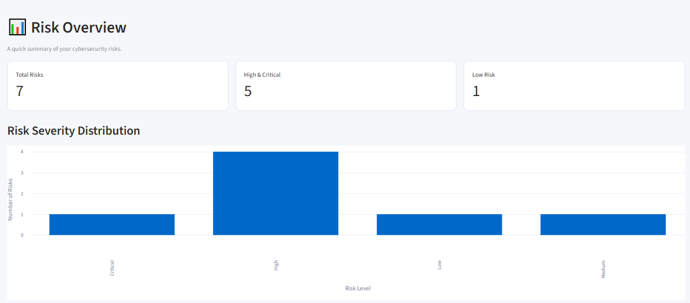
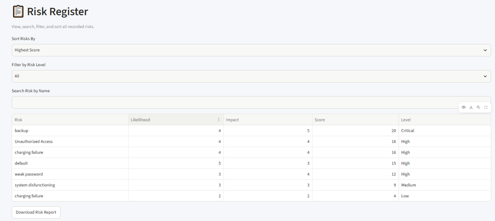

# SecureTrack 🔐

A Cybersecurity Risk and Compliance Tracker built using Python, Streamlit, and SQLite.

## About the Project

SecureTrack is a simple web-based application that helps users identify cybersecurity risks, calculate their severity, manage security controls, and track risk mitigation plans.

## Features

- Add, edit, search, filter, and delete cybersecurity risks.
- Automatically calculate risk scores and severity levels.
- View a risk overview dashboard.
- Manage security controls and compliance status.
- Create and track risk mitigation plans.
- Sort risks by severity score.
- Download risk reports as CSV files.

## Technologies Used

- Python
- Streamlit
- SQLite
- SQL
- Pandas

## Risk Calculation

Risk Score = Likelihood × Impact

Risk levels:

- 1–4: Low
- 5–9: Medium
- 10–16: High
- 17–25: Critical

## How to Run

1. Install Python.
2. Install the required libraries:

   `pip install streamlit pandas`

3. Open the project folder in VS Code.
4. Run:

   `python -m streamlit run dashboard.py`

5. Open the local URL displayed in the terminal.

## Future Improvements

- User authentication.
- More detailed compliance reports.
- Additional cybersecurity frameworks.

## Screenshots

### Risk Overview

### Risk Register

